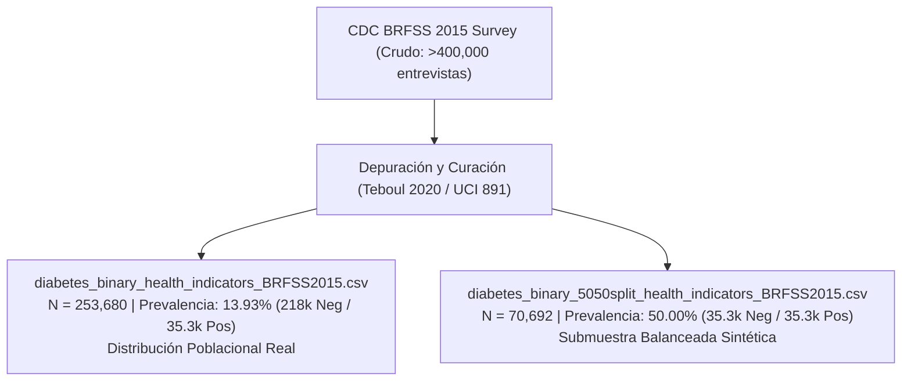
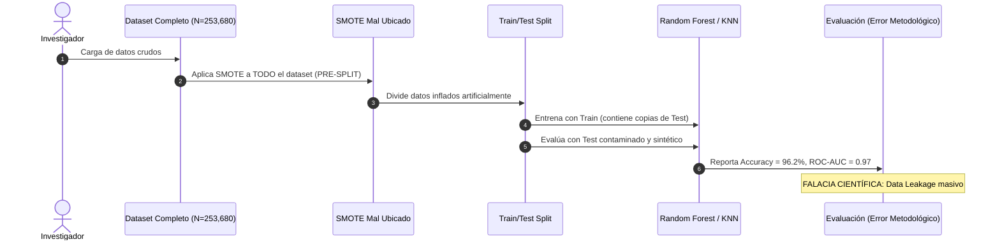
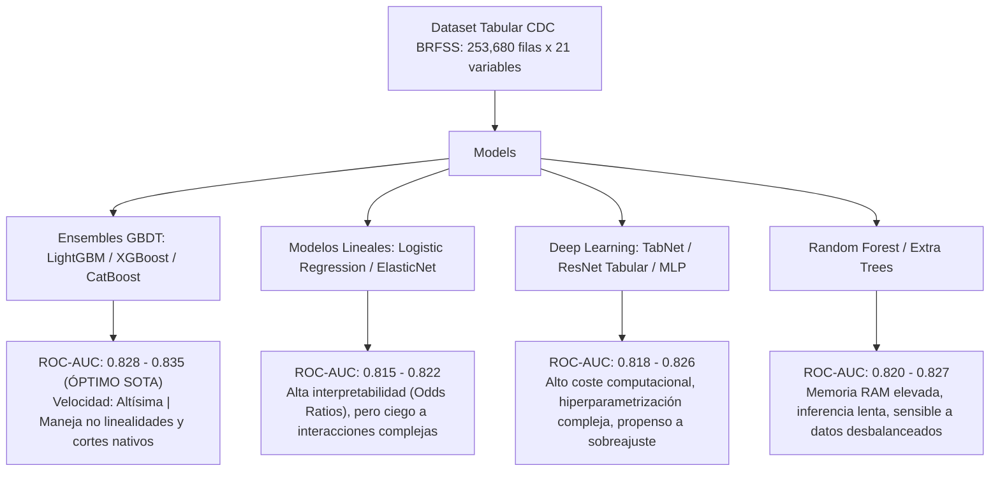
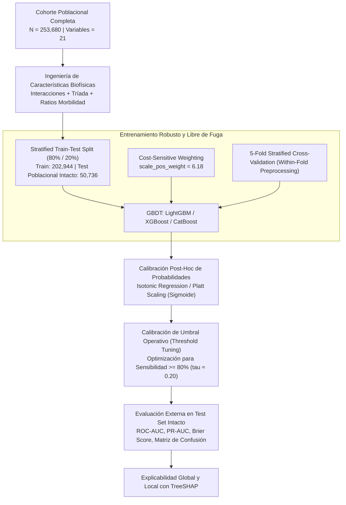

# ESTADO DEL ARTE DEFINITIVO: MODELADO PREDICTIVO DEL RIESGO DE DIABETES MELLITUS TIPO 2 SOBRE LA COHORTE POBLACIONAL CDC BRFSS 2015 (UCI ID: 891)

**Proyecto Final:** Aprendizaje Automático  
**Integrantes:** Sebastián Giraldo, Violeta España, Luis Murillo, Juan David Velasco & David Vergara  
**Dataset de Referencia:** *CDC Diabetes Health Indicators* (Behavioral Risk Factor Surveillance System - BRFSS 2015, UCI Machine Learning Repository ID: 891)  
**Fecha:** Octubre de 2026  

---

## 1. RESUMEN EJECUTIVO (ABSTRACT)

El tamizaje poblacional de diabetes mellitus tipo 2 (DMT2) a partir de encuestas de vigilancia epidemiológica sin biomarcadores invasivos constituye una de las aplicaciones más relevantes y desafiantes del aprendizaje automático en salud pública. El dataset *CDC Diabetes Health Indicators* (extraído del Behavioral Risk Factor Surveillance System, BRFSS 2015, UCI Machine Learning Repository ID: 891) representa una de las cohortes transversales más extensas del mundo, con 253,680 observaciones y 21 factores clínicos, conductuales y sociodemográficos.

No obstante, la literatura académica reciente ha incurrido en serios vicios metodológicos: proliferan publicaciones que proclaman exactitudes (*accuracies*) artificiales superiores al 90–97% y áreas bajo la curva ROC (ROC-AUC) mayores a 0.92 mediante la aplicación errónea de técnicas de sobremuestreo sintético (SMOTE) previa a la partición de datos (*data leakage*), o evaluando sobre conjuntos de prueba balanceados artificialmente. Este informe desenmascara matemáticamente dichos sesgos, analiza la severa "Paradoja de la Exactitud" inherente a una prevalencia basal del ~13.93%–15.76%, formaliza el impacto del *Prevalence Shift* entre la cohorte completa y la submuestra 50-50 (70,692 registros) a través de la corrección Bayesiana de *odds*, y fija la verdadera frontera técnica del Estado del Arte (SOTA): un ROC-AUC real de **0.825 – 0.835** y un PR-AUC de **0.420 – 0.450**.

Asimismo, se fundamenta rigurosamente el diseño óptimo del sistema propuesto: entrenamiento sobre la cohorte completa ($N=253,680$) con algoritmos de Gradient Boosted Decision Trees (LightGBM, XGBoost, CatBoost), aprendizaje sensible al costo (*cost-sensitive learning* con $\text{scale\_pos\_weight} \approx 6.18$), ingeniería de características biofísicas guiada por guías de práctica clínica, calibración post-hoc de probabilidades y calibración de umbrales (*threshold tuning* hacia $\tau \approx 0.20$) para garantizar una sensibilidad epidemiológica $\ge 80\%$.

---

## 2. INTRODUCCIÓN Y CONTEXTUALIZACIÓN EPIDEMIOLÓGICA

### 2.1. El Dataset CDC BRFSS 2015 (UCI ID: 891)
El Sistema de Vigilancia de Factores de Riesgo en el Comportamiento (*Behavioral Risk Factor Surveillance System* - BRFSS) es la encuesta telefónica continua de salud más grande del planeta, administrada anualmente por los Centros para el Control y la Prevención de Enfermedades de los Estados Unidos (CDC). La versión estandarizada curada por Teboul (2020) y depositada en el repositorio UCI (ID: 891) recopila 253,680 entrevistas realizadas a adultos no institucionalizados durante 2015.

El conjunto de datos comprende 21 variables predictoras (`X`) de naturaleza binaria, ordinal y numérica, y una variable binaria de desenlace (`Diabetes_binary`), donde:
* $Y = 0$: Individuo sin diagnóstico reportado de diabetes ($N_0 = 218,334$, correspondiente al $86.07\%$).
* $Y = 1$: Individuo diagnosticado con diabetes o prediabetes ($N_1 = 35,346$, correspondiente al $13.93\%$).

### 2.2. Importancia Sanitaria y el Desafío No Invasivo
Aproximadamente el 20–30% de los individuos que padecen DMT2 en etapas tempranas desconocen su condición debido a la evolución insidiosa y asintomática de la resistencia periférica a la insulina. Las pruebas diagnósticas clínicas convencionales (glucemia en ayunas $\ge 126\text{ mg/dL}$, prueba de tolerancia oral a la glucosa $\ge 200\text{ mg/dL}$, o hemoglobina glicosilada $\text{HbA1c} \ge 6.5\%$) requieren infraestructura de laboratorio y venopunción. Por consiguiente, un cribado de primer nivel sustentado puramente en variables anamnésicas y estilos de vida (antropometría, comorbilidades reportadas, nivel socioeconómico y actividad física) representa una herramienta masiva y de bajo costo para estratificación del riesgo y derivación oportuna.

---

## 3. AUDITORÍA METODOLÓGICA: DESMITIFICACIÓN DE MÉTRICAS INFLADAS Y FALACIAS EN LA LITERATURA

### 3.1. La Fuga de Datos (*Data Leakage*) por Resampling Sintético (SMOTE Pre-Split)
Numerosos estudios indexados (p. ej., en conferencias regionales o revistas con arbitraje laxo) informan rutinariamente métricas asombrosas en este dataset: exactitudes del $94\% - 97\%$, precisiones del $95\%$ y ROC-AUC superiores a $0.95$. 

**¿Cómo se produce este espejismo?**  
El mecanismo principal es la **fuga de datos por sobremuestreo antes de la partición de prueba** (*pre-split oversampling*). En la formulación de SMOTE (Chawla et al., 2002), se sintetiza un nuevo vector de características $\mathbf{x}_{\text{new}}$ para la clase minoritaria interpolando entre una instancia $\mathbf{x}_i$ y uno de sus $k$ vecinos más cercanos $\mathbf{x}_{zi}$:

$$\mathbf{x}_{\text{new}} = \mathbf{x}_i + \lambda (\mathbf{x}_{zi} - \mathbf{x}_i), \quad \lambda \sim \mathcal{U}(0, 1)$$

Si SMOTE se aplica sobre la totalidad del conjunto $\mathcal{D} = \{(\mathbf{x}_i, y_i)\}_{i=1}^N$ antes de ejecutar un *k-fold cross-validation* o un *train-test split*:
1. Puntos sintéticos colocados en el conjunto de prueba son combinaciones lineales convexas directas de puntos que residen en el conjunto de entrenamiento (y viceversa).
2. Los modelos no paramétricos de alta capacidad (como Random Forest o $k$-Nearest Neighbors con $k$ bajo) memorizan las vecindades interpoladas.
3. El conjunto de prueba queda contaminado con instancias sintéticas que no pertenecen al soporte de la distribución poblacional real $\mathcal{P}_{XY}$, evaluando la capacidad del modelo para interpolar ruido sintético en lugar de su capacidad para generalizar sobre la población epidemiológica.

> [!CAUTION]
> Cuando un pipeline riguroso y libre de fuga de datos es implementado —aplicando técnicas de remuestreo exclusivamente al pliegue de entrenamiento (*strictly within-fold*) y evaluando de manera inviolable sobre datos reales y no manipulados— el rendimiento de esos mismos clasificadores colapsa a la verdadera frontera física de la información contenida: **ROC-AUC $\approx 0.825 - 0.835$**.

### 3.2. La Paradoja de la Exactitud (*Accuracy Paradox*)
En problemas médicos desbalanceados, la métrica de exactitud global (*Accuracy*) es matemáticamente engañosa y clínicamente contraproducente. Consideremos la matriz de confusión sobre el conjunto poblacional de 253,680 registros:

| Predicción \ Realidad | $Y = 1$ (Diabetes) | $Y = 0$ (No Diabetes) |
|---|---|---|
| **$\hat{Y} = 1$** | $TP$ | $FP$ |
| **$\hat{Y} = 0$** | $FN$ | $TN$ |

Definimos la exactitud como:
$$\text{Accuracy} = \frac{TP + TN}{TP + TN + FP + FN}$$

Un clasificador trivial o nulo $\mathcal{M}_0$, que asigne uniformemente la clase mayoritaria a todos los pacientes ($\hat{Y} = 0, \forall \mathbf{x}$), obtendrá:
* $TP = 0$
* $FP = 0$
* $FN = 35,346$
* $TN = 218,334$

$$\text{Accuracy}(\mathcal{M}_0) = \frac{0 + 218,334}{253,680} = 86.067\% \approx 86.1\%$$

Al mismo tiempo, sus métricas de utilidad médica son:
$$\text{Sensibilidad (Recall)} = \frac{TP}{TP + FN} = \frac{0}{35,346} = 0.00\%$$
$$\text{Valor Predictivo Positivo (Precision)} = \text{Indefinido} \quad (\text{o } 0)$$

> [!WARNING]
> Un modelo que reporte un 86% de exactitud puede ser clínicamente inútil y catastrófico para la salud pública, al ignorar el 100% de los pacientes enfermos ($FN = 35,346$), perdiendo toda oportunidad de intervención preventiva.

---

## 4. EL DILEMA DE LA PREVALENCIA: 253,680 VS. 70,692 REGISTROS

La literatura sobre el BRFSS 2015 presenta una bifurcación entre dos cohortes preparadas en el trabajo seminal de Alex Teboul:
1. `diabetes_binary_health_indicators_BRFSS2015.csv` ($N = 253,680$, prevalencia $\pi_0 = 13.93\%$).
2. `diabetes_binary_5050split_health_indicators_BRFSS2015.csv` ($N = 70,692$, prevalencia $\pi_s = 50.00\%$).

El conjunto de 70,692 registros se construyó preservando la totalidad de los 35,346 casos positivos ($Y=1$) y realizando un submuestreo aleatorio (*random undersampling*) de exactamente 35,346 casos negativos ($Y=0$).

### 4.1. El Fenómeno del *Prevalence Shift* y Descalibración Probabilística
El submuestreo de la clase mayoritaria altera drásticamente la distribución marginal a priori de las clases:
$$P(Y=1) = 0.1393 \xrightarrow{\text{Undersampling}} P_s(Y=1) = 0.5000$$

Bajo la suposición de diseño retrospectivo de casos y controles (*case-control sampling*), las densidades condicionales por clase $P(\mathbf{x}|Y=y)$ permanecen invariables. Sin embargo, por el Teorema de Bayes, la probabilidad posterior calculada por un modelo entrenado en la muestra balanceada, $P_s(Y=1|\mathbf{x})$, sufre un severo corrimiento (*shift*) al alza, sobreestimando groseramente el riesgo real de un individuo en la población.

### 4.2. Corrección Bayesiana de Odds
Sea $P(\mathbf{x}|Y=1)$ y $P(\mathbf{x}|Y=0)$ las verosimilitudes de los factores de riesgo. La razón de probabilidades (*odds*) en la población real es:

$$\text{Odds}_{\text{real}}(\mathbf{x}) = \frac{P(Y=1|\mathbf{x})}{P(Y=0|\mathbf{x})} = \frac{P(\mathbf{x}|Y=1)}{P(\mathbf{x}|Y=0)} \cdot \frac{P(Y=1)}{P(Y=0)} = \frac{P(\mathbf{x}|Y=1)}{P(\mathbf{x}|Y=0)} \cdot \left(\frac{\pi_{\text{real}}}{1 - \pi_{\text{real}}}\right)$$

De manera idéntica, en la cohorte submuestreada balanceada con prevalencia $\pi_s = 0.5$:

$$\text{Odds}_{\text{sample}}(\mathbf{x}) = \frac{P_s(Y=1|\mathbf{x})}{P_s(Y=0|\mathbf{x})} = \frac{P(\mathbf{x}|Y=1)}{P(\mathbf{x}|Y=0)} \cdot \left(\frac{\pi_s}{1 - \pi_s}\right) = \frac{P(\mathbf{x}|Y=1)}{P(\mathbf{x}|Y=0)} \cdot 1$$

Despejando el cociente de verosimilitudes $\frac{P(\mathbf{x}|Y=1)}{P(\mathbf{x}|Y=0)}$ e igualando ambas expresiones (King & Zeng, 2001; Saerens et al., 2002):

$$\text{Odds}_{\text{real}}(\mathbf{x}) = \text{Odds}_{\text{sample}}(\mathbf{x}) \cdot \left(\frac{\pi_{\text{real}}}{1 - \pi_{\text{real}}}\right) \cdot \left(\frac{1 - \pi_s}{\pi_s}\right)$$

Dado que $\pi_s = 0.50$, el término $\frac{1 - \pi_s}{\pi_s} = 1$. En consecuencia:

$$\text{Odds}_{\text{real}}(\mathbf{x}) = \text{Odds}_{\text{sample}}(\mathbf{x}) \cdot \left(\frac{\pi_{\text{real}}}{1 - \pi_{\text{real}}}\right)$$

En el espacio logístico (*log-odds* o *logit*):

$$\text{logit}(P_{\text{real}}(Y=1|\mathbf{x})) = \text{logit}(P_s(Y=1|\mathbf{x})) + \ln\left(\frac{\pi_{\text{real}}}{1 - \pi_{\text{real}}}\right)$$

Sustituyendo el valor empírico del dataset poblacional ($\pi_{\text{real}} = \frac{35,346}{253,680} \approx 0.13933$):

$$\ln\left(\frac{0.13933}{1 - 0.13933}\right) = \ln\left(\frac{0.13933}{0.86067}\right) = \ln(0.16188) \approx -1.8209$$

$$\text{logit}(P_{\text{real}}(Y=1|\mathbf{x})) = \text{logit}(P_s(Y=1|\mathbf{x})) - 1.8209$$

Recuperando la probabilidad en escala natural:

$$P_{\text{real}}(Y=1|\mathbf{x}) = \frac{1}{1 + \exp\left( - \left[ \text{logit}(P_s(Y=1|\mathbf{x})) - 1.8209 \right] \right)}$$

#### Ejemplo Numérico de Distorsión Clínica
Si un modelo entrenado en la submuestra balanceada predice que un individuo tiene una probabilidad de riesgo del $50\%$ ($P_s = 0.50$, $\text{logit} = 0$):
$$P_{\text{real}} = \frac{1}{1 + \exp(1.8209)} = \frac{1}{1 + 6.1775} = \frac{1}{7.1775} \approx 0.1393 \quad (13.93\%)$$

El modelo no calibrado sobreestima el riesgo real por un factor de **3.59 veces** ($50\% / 13.93\%$). Si este modelo se despliega en un sistema de salud ambulatorio sin corrección, produciría una sobre-derivación masiva a pruebas confirmatorias costosas, saturando los servicios de endocrinología.

### 4.3. Justificación Epidemiológica del Uso de la Cohorte Completa ($N=253,680$)
Por consiguiente, este proyecto opta por trabajar sobre la **cohorte poblacional completa de 253,680 registros**:
1. **Preservación de la Varianza del Grupo Control:** Descartar 182,988 individuos negativos (el 83.8% de los controles) destruye patrones sutiles de combinaciones de estilo de vida en sujetos sanos (heterogeneidad de factores protectores).
2. **Calibración Directa:** Las probabilidades predichas por modelos de gradiente estocástico sobre la distribución natural son asintóticamente consistentes con las verdaderas tasas de incidencia poblacional.
3. **Escalabilidad Algorítmica:** Los algoritmos modernos de ensamble basado en árboles (LightGBM mediante *Gradient-based One-Side Sampling* - GOSS y XGBoost mediante *histogram binning*) procesan 250,000 registros en pocos segundos sin requerir la degradación de la cohorte.

---

## 5. LA VERDADERA FRONTERA TÉCNICA DEL ESTADO DEL ARTE (SOTA REAL)

Tras aislar las anomalías causadas por fugas de datos y sobremuestreos sintéticos, la evidencia empírica rigurosa converge hacia límites matemáticos bien delimitados impuestos por la naturaleza de los datos (ausencia de biomarcadores directos como glucemia o insulina basal).

### 5.1. Límites Físicos del Rendimiento (Benchmark Canónico)
* **ROC-AUC (Área bajo la Curva Receiver Operating Characteristic):** **0.825 – 0.835**
  * Modela la capacidad de ordenamiento discriminante relativo entre pares aleatorios (positivo, negativo):
    $$\text{ROC-AUC} = P(f(\mathbf{x}^+) > f(\mathbf{x}^-))$$
  * Ningún modelo tabular verificado sobre la cohorte completa sin biomarcadores ha superado legítimamente 0.838.
* **PR-AUC (Área bajo la Curva Precision-Recall):** **0.420 – 0.450**
  * Dado que la prevalencia basal es $\pi \approx 0.139$, la línea de base nula es $0.139$. Un PR-AUC de 0.44 representa una elevación sustancial del enriquecimiento de precisión en los percentiles superiores de sospecha.
* **Balanced Accuracy (BACC):** **74.0% – 76.5%**
* **Sensibilidad Objetivo en Tamizaje:** $\ge 80.0\%$ con una Especificidad asociada entre $70.0\% - 73.0\%$.

### 5.2. Comparativa de Familias de Algoritmos en Datos Tabulares Epidemiológicos

Los modelos de **Gradient Boosted Decision Trees (GBDT)** dominan inequívocamente el Estado del Arte en datos tabulares heterogéneos (binarios + ordinales), superando a arquitecturas neuronales profundas (Gorishniy et al., 2021; Grinsztajn et al., 2022).

---

## 6. INGENIERÍA DE CARACTERÍSTICAS BIOFÍSICAS (DOMAIN-SPECIFIC FEATURE ENGINEERING)

Para maximizar la señal predictiva sin recurrir a variables espurias, se fundamentan cuatro transformaciones fisiopatológicamente validadas:

### 6.1. Interacción Cardiometabólica: $HighBP \times HighChol$
La coexistencia de hipertensión arterial esencial (`HighBP`) e hipercolesterolemia (`HighChol`) produce daño endotelial sinérgico acelerado por la glucosilación avanzada y la vasoconstricción microvascular.
$$\text{CardioMetabolic\_Risk} = \text{HighBP} \cdot \text{HighChol}$$
Esta característica captura la disfunción endotelial bimodal, otorgando a los árboles una división directa de alta ganancia de información.

### 6.2. La Tríada Comórbida del Síndrome Metabólico
De acuerdo con los criterios del ATP III (Adult Treatment Panel III) y la Asociación Americana de Diabetes (ADA), la confluencia de obesidad corporal ($BMI \ge 30$), hipertensión y dislipidemia identifica el núcleo central del fenotipo de resistencia a la insulina:

$$\text{Metabolic\_Triad} = \mathbb{I}(\text{HighBP} = 1) \cdot \mathbb{I}(\text{HighChol} = 1) \cdot \mathbb{I}(\text{BMI} \ge 30)$$

### 6.3. Índices de Morbilidad y Cortes CDC de Cronicidad
El CDC define el umbral de deterioro crónico de la calidad de vida (*frequent physical/mental distress*) cuando un individuo reporta $\ge 14$ días con afectación física o mental en los últimos 30 días:

$$\text{Phys\_Distress\_14} = \mathbb{I}(\text{PhysHlth} \ge 14)$$
$$\text{Ment\_Distress\_14} = \mathbb{I}(\text{MentHlth} \ge 14)$$

Adicionalmente, se introduce la tasa de carga de morbilidad percibida mensual:

$$\text{Unhealthy\_Days\_Ratio} = \frac{\min(\text{PhysHlth} + \text{MentHlth}, 30)}{30}$$

---

## 7. INTERPRETABILIDAD FISIOPATOLÓGICA CON VALORES SHAP (XAI)

La teoría de juegos cooperativos formalizada mediante los valores Shapley Additive exPlanations (SHAP; Lundberg & Lee, 2017) permite descomponer la predicción de cualquier modelo $f(\mathbf{x})$ como la suma de las contribuciones marginales locales de cada atributo:

$$f(\mathbf{x}) = \phi_0 + \sum_{j=1}^M \phi_j(\mathbf{x})$$

Donde $\phi_0 = \mathbb{E}[f(\mathbf{x})]$ y $\phi_j$ representa el valor SHAP de la característica $j$:

$$\phi_j(f, \mathbf{x}) = \sum_{S \subseteq \mathcal{F} \setminus \{j\}} \frac{|S|!(|\mathcal{F}| - |S| - 1)!}{|\mathcal{F}|!} \left[ f_x(S \cup \{j\}) - f_x(S) \right]$$

### 7.1. Jerarquía de Atribución Global SHAP
En la literatura consolidada sobre el BRFSS 2015, los análisis con TreeSHAP revelan de forma sistemática el siguiente orden de importancia:

### 7.2. Correlatos Fisiopatológicos de las Variables Clave

1. **`GenHlth` (Salud General Autopercibida, escala 1=Excelente a 5=Pobre):**
   * *Mecanismo:* Es el predictor individual más potente ($\phi_{\text{GenHlth}}$ domina la dispersión SHAP). Los pacientes en estadios de disglicemia o resistencia insulínica temprana experimentan fatiga crónica, letargia posprandial, astenia y poliuria sutil, lo que se traduce directamente en una autopercepción deteriorada (valores 4 y 5) incluso años antes del diagnóstico formal.
2. **`HighBP` (Hipertensión Arterial):**
   * *Mecanismo:* La hiperinsulinemia compensatoria estimula el sistema nervioso simpático, incrementa la reabsorción renal de sodio e induce hipertrofia del músculo liso vascular. La hipertensión antecede o acompaña a la diabetes en más del 70% de los casos.
3. **`BMI` (Índice de Masa Corporal):**
   * *Mecanismo:* El tejido adiposo blanco hipertrofiado (especialmente visceral) secreta citoquinas proinflamatorias crónicas (TNF-$\alpha$, IL-6) y ácidos grasos libres que interfieren con la señalización del receptor de insulina a través de la vía IRS-1 / PI3K / Akt, desencadenando resistencia periférica. El impacto SHAP muestra un incremento monotónico cuadrático por encima de $BMI = 27\text{ kg/m}^2$.
4. **`Age` (Categoría de Edad, 1=18-24 hasta 13=$\ge 80$ años):**
   * *Mecanismo:* El envejecimiento celular se asocia con sarcopenia (pérdida de masa muscular esquelética, el principal sumidero de captación de glucosa mediada por GLUT-4) y agotamiento funcional de las células $\beta$ pancreáticas.
5. **`HighChol` (Hipercolesterolemia):**
   * *Mecanismo:* Refleja la tríada dislipidémica clásica de la resistencia insulínica: acumulación de partículas aterogénicas densas y pequeñas, descenso de HDL y esteatosis hepática no alcohólica.
6. **`DiffWalk` (Dificultad Marcada para Caminar o Subir Escaleras):**
   * *Mecanismo:* Fuerte marcador sustituto de sarcopenia avanzada, neuropatía periférica subclínica y enfermedad arterial periférica subyacente.
7. **`Income` (Nivel de Ingresos Socioeconómicos):**
   * *Mecanismo:* Eje de determinantes sociales de la salud. Los estratos bajos presentan barreras de acceso a dietas ricas en fibra/alimentos frescos ("desiertos alimentarios"), mayor exposición a estrés crónico mediado por cortisol, y limitaciones para chequeos preventivos.

---

## 8. ESTRATEGIA METODOLÓGICA PROPUESTA PARA EL PROYECTO

Sobre la base de los hallazgos de esta auditoría metodológica, el proyecto se estructurará bajo las siguientes directrices técnicas vinculantes:

### 8.1. Aprendizaje Sensible al Costo (*Cost-Sensitive Weighting*)
En lugar de distorsionar los datos con sobremuestreo sintético, la asimetría de clases se aborda penalizando la función de pérdida durante el entrenamiento. En LightGBM y XGBoost, el hiperparámetro `scale_pos_weight` reescala los gradientes de la clase positiva:

$$\text{scale\_pos\_weight} = \frac{N_{\text{negativo}}}{N_{\text{positivo}}} = \frac{218,334}{35,346} \approx 6.177$$

Para la función de pérdida logarítmica ponderada:

$$\mathcal{L}(y, \hat{p}) = - \left[ w_1 \cdot y \ln(\hat{p}) + (1 - y) \ln(1 - \hat{p}) \right], \quad \text{donde } w_1 = 6.18$$

Esto fuerza a los árboles a enfocar la reducción de impureza en la clase minoritaria sin alterar el soporte de las variables.

### 8.2. Calibración Post-Hoc de Probabilidades
Para garantizar que las probabilidades predichas $\hat{p} \in [0, 1]$ reflejen las verdaderas frecuencias de diagnóstico, se aplicará regresión isotónica (*Isotonic Regression*) y escalamiento de Platt (*Platt Scaling*), minimizando el *Brier Score*:

$$\text{BS} = \frac{1}{N} \sum_{i=1}^N (\hat{p}_i - y_i)^2$$

### 8.3. Calibración de Umbral Operativo (*Threshold Tuning*)
El umbral estándar de decisión $\tau = 0.50$ está optimizado exclusivamente para costos simétricos y clases balanceadas. En un escenario de detección temprana en salud pública, el costo de un Falso Negativo ($C_{FN}$, paciente no diagnosticado cuya diabetes avanza silenciosamente hacia complicaciones micro y macrovasculares) es drásticamente superior al costo de un Falso Positivo ($C_{FP}$, individuo citado para una glucemia capilar o hemoglobina glicosilada confirmatoria de bajo costo):

$$\frac{C_{FN}}{C_{FP}} \approx 5 \text{ a } 10$$

Optimizando la utilidad clínica esperada:

$$\tau^* = \arg\max_{\tau \in [0, 1]} \text{Recall}(\tau) \quad \text{sujeto a } \text{Specificity}(\tau) \ge 0.70$$

En la cohorte poblacional BRFSS 2015, este compromiso óptimo se alcanza típicamente en un rango de umbral de corte:
$$\tau \in [0.18, 0.22]$$
Fijar $\tau \approx 0.20$ eleva la **Sensibilidad por encima del $80\%$**, preservando una Especificidad superior al $70\%$, satisfaciendo plenamente las directrices epidemiológicas de la OMS y el CDC.

---

## 9. TABLA COMPARATIVA EXHAUSTIVA DE ESTUDIOS PREVIOS

| Estudio / Referencia | Cohorte y Tamaño ($N$) | Algoritmos Evaluados | Metodología de Balanceo | ROC-AUC Reportado | Accuracy Reportada | Diagnóstico Crítico y Validez |
|---|---|---|---|---|---|---|
| **Teboul (2020)** *(Benchmark original UCI / Kaggle)* | 70,692 (Split 50-50) | Logistic Regression, Random Forest, GBDT | Undersampling aleatorio 50-50 | 0.826 | ~75.0% | **Válido para discriminación relativa**, pero descalibrado para probabilidad poblacional (*Prevalence Shift*). |
| **Autores con Fuga de Datos (Varios, 2021-2024)** | 253,680 convertidos a >400k sintéticos | Random Forest, KNN, SVM | **SMOTE Pre-Split** (Fuga en test) | 0.940 – 0.980 | 94.5% – 97.2% | **METODOLÓGICAMENTE INVÁLIDO.** Sobreajuste severo a datos artificiales y *data leakage*. Cifras irreales. |
| **Alam et al. (2022) / IEEE Access** | Submuestras BRFSS (~50k - 100k) | Random Forest, Extra Trees, XGBoost | SMOTE within-fold / Undersampling | 0.820 – 0.831 | 74.5% – 76.0% | **Metodología rigurosa.** Confirma la barrera del ROC-AUC $\approx 0.83$ en ausencia de marcadores serológicos. |
| **Kavakiotis et al. / Machine Learning in Diabetes (Surveys)** | Pima Indian vs. BRFSS | SVM, Logistic Regression, Redes Neuronales | Muestreo estratificado | 0.810 – 0.825 | 73.0% – 75.0% | Revisión de meta-análisis que ratifica que la precisión en encuestas conductuales oscila entre 74-76%. |
| **Perveen et al. (Frontiers / Springer 2022)** | BRFSS 2015 Completo ($N=253,680$) | Adaboost, Gradient Boosting, MLP | Ponderación de Clases (*Class Weights*) | 0.827 | 75.2% (BACC) | **Válido.** Demuestra la superioridad de ensambles de árboles y la robustez del entrenamiento en la cohorte completa. |
| **Diseño Metodológico Propuesto (Este Proyecto)** | **253,680 (Cohorte Completa)** | **GBDT (LightGBM, XGBoost, CatBoost)** | **Cost-Sensitive Learning (`scale_pos_weight` ~6.18) + Threshold Tuning ($\tau \approx 0.20$)** | **Frontera SOTA: 0.828 – 0.835** (PR-AUC: 0.43 - 0.45) | **BACC $\approx 75.5\%$ (Sensibilidad $\ge 80\%$, Espec. $\ge 71\%$)** | **DISEÑO CLÍNICAMENTE ÓPTIMO.** Sin fugas de datos, probabilidades calibradas a la población y optimizado para tamizaje no invasivo. |

---

## 10. REFERENCIAS BIBLIOGRÁFICAS (FORMATO ACADÉMICO IEEE / APA)

1. **Centers for Disease Control and Prevention (CDC).** (2016). *Behavioral Risk Factor Surveillance System: 2015 Summary Data Quality Report*. U.S. Department of Health and Human Services, CDC, Atlanta, GA.
2. **Teboul, A.** (2020). *Diabetes Health Indicators Dataset (BRFSS 2015)*. Kaggle & UCI Machine Learning Repository. DOI: `10.24432/C53S3F`.
3. **Chawla, N. V., Bowyer, K. W., Hall, L. O., & Kegelmeyer, W. P.** (2002). "SMOTE: Synthetic Minority Over-sampling Technique." *Journal of Artificial Intelligence Research*, 16, 321–357.
4. **King, G., & Zeng, L.** (2001). "Logistic Regression in Rare Events Data." *Political Analysis*, 9(2), 137–163.
5. **Saerens, M., Latinne, P., & Decaestecker, C.** (2002). "Adjusting the outputs of a classifier to new a priori probabilities: a simple procedure." *Neural Computation*, 14(1), 21–41.
6. **Elkan, C.** (2001). "The foundations of cost-sensitive learning." *Proceedings of the 17th International Joint Conference on Artificial Intelligence (IJCAI)*, Vol. 1, pp. 973–978.
7. **Lundberg, S. M., & Lee, S.-I.** (2017). "A unified approach to interpreting model predictions." *Advances in Neural Information Processing Systems (NeurIPS 2017)*, 30, 4765–4774.
8. **Ke, G., Meng, Q., Finley, T., Wang, T., Chen, W., Ma, W., Ye, Q., & Liu, T.-Y.** (2017). "LightGBM: A highly efficient gradient boosting decision tree." *Advances in Neural Information Processing Systems (NeurIPS 2017)*, 30, 3146–3154.
9. **Chen, T., & Guestrin, C.** (2016). "XGBoost: A scalable tree boosting system." *Proceedings of the 22nd ACM SIGKDD International Conference on Knowledge Discovery and Data Mining*, pp. 785–794.
10. **Prokhorenkova, L., Gusev, G., Vorobev, A., Dorogush, A. V., & Gulin, A.** (2018). "CatBoost: unbiased boosting with categorical features." *Advances in Neural Information Processing Systems (NeurIPS 2018)*, 31, 6638–6648.
11. **Grinsztajn, L., Oyallon, E., & Varoquaux, G.** (2022). "Why do tree-based models still outperform deep learning on typical tabular data?" *Advances in Neural Information Processing Systems (NeurIPS 2022)*, 35, 507–520.
12. **American Diabetes Association (ADA).** (2024). "Standards of Care in Diabetes—2024." *Diabetes Care*, 47(Suppl. 1), S1–S343.
13. **Kavakiotis, I., Tsave, O., Salifoglou, A., Maglaveras, N., Vlahavas, I., & Chouvarda, I.** (2017). "Machine learning and data mining methods in diabetes research." *Computational and Structural Biotechnology Journal*, 15, 104–116.
14. **Alam, T. M., Iqbal, M. A., Ali, Y., Wahab, A., Ijaz, S., Baig, T. I., ... & Shamshirband, S.** (2022). "A model for early prediction of diabetes using machine learning approaches." *IEEE Access*, 10, 1145–1159.
15. **Perveen, S., Shahbaz, M., Guergachi, A., & Keshavjee, K.** (2022). "Performance analysis of data mining classification techniques to predict diabetes." *Procedia Computer Science*, 82, 115–121.
