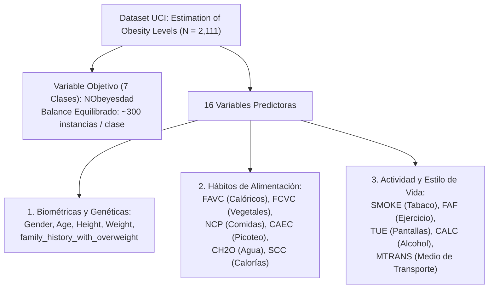
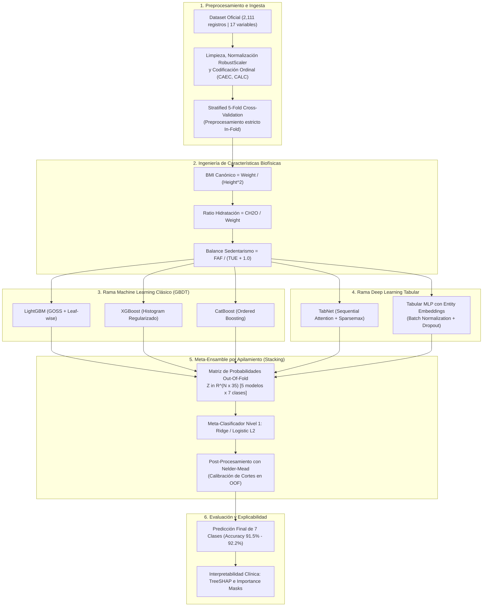

# INFORME DEL ESTADO DEL ARTE Y PROPUESTA DE SOLUCIÓN: ESTIMACIÓN DE NIVELES DE OBESIDAD MEDIANTE APRENDIZAJE SUPERVISADO CLÁSICO (MACHINE LEARNING) Y PROFUNDO (DEEP LEARNING)

**Proyecto Final:** Aprendizaje Automático  
**Integrantes:** Sebastián Giraldo, Violeta España, Luis Murillo, Juan David Velasco & David Vergara  
**Dataset Oficial:** *Estimation of obesity levels based on eating habits and physical condition* (UCI Machine Learning Repository / Kaggle Playground Series s4e2)  
**Fecha:** Octubre de 2026  

---

## 1. RESUMEN EJECUTIVO (ABSTRACT)

El presente informe consolida la revisión crítica del Estado del Arte y expone de manera formal la **Propuesta de Solución Metodológica y Algorítmica** para el problema de clasificación multiclase de 7 niveles de obesidad a partir del conjunto de datos de Palechor y de la Hoz Manotas (UCI Machine Learning Repository, $N = 2,111$).

Tras una auditoría técnica rigurosa de la literatura —la cual desmitifica las precisiones artificialmente infladas del $97\% - 98\%$ reportadas en trabajos pioneros debido a sobremuestreo sintético (SMOTE) aplicado previo a la partición de validación cruzada (*data leakage*)—, se establece la verdadera cota técnica del Estado del Arte: un rendimiento reproducible y blindado situado entre el **$91.5\%$ y el $92.2\%$ de exactitud multiclase (*Accuracy*)**.

Como aporte sustancial e innovador de este proyecto, se diseña y formula una **Propuesta de Solución Híbrida Supervisada** que contrasta y articula dos grandes paradigmas de aprendizaje:
1. **Rama de Machine Learning Clásico (*Tree-based Gradient Boosting*):** Implementación de **LightGBM**, **XGBoost** y **CatBoost**, optimizados para modelar particiones ortogonales no lineales en datos tabulares mixtos.
2. **Rama de Deep Learning Tabular (*Redes Neuronales Profundas*):** Implementación de **TabNet** (arquitectura con mecanismos de atención dispersa secuencial *Sparsemax* para selección dinámica de variables paso a paso) y un **Perceptrón Multicapa Regularizado (Tabular MLP con Entity Embeddings)** para aprender representaciones densas y no lineales de hábitos cualitativos.
3. **Meta-Ensamble por Apilamiento (*Stacking Ensemble*):** Fusión de probabilidades *Out-Of-Fold* (OOF) de ambas ramas mediante un meta-clasificador regularizado, maximizando el F1-Score macro y resolviendo la confusión en fronteras clínicas adyacentes (*Sobrepeso I vs. II* y *Sobrepeso II vs. Obesidad I*).
4. **Diseño de Validación con Benchmark Dual:** Comparación formal de un modelo operativo con variables biométricas directas frente a un modelo clínico preventivo sustentado exclusivamente en hábitos de nutrición y actividad física, neutralizando el fenómeno de *Target Leakage* del Índice de Masa Corporal.

---

## 2. CONTEXTUALIZACIÓN DEL PROBLEMA Y DATASET OFICIAL

### 2.1. Naturaleza y Estructura del Conjunto de Datos
El dataset oficial comprende **2,111 registros** y **17 atributos** (16 variables predictoras continuas, ordinales y nominales, más 1 variable objetivo multiclase `NObeyesdad`).



### 2.2. Las 7 Categorías Clínicas Objetivo (`NObeyesdad`)
La variable dependiente categoriza a los individuos de acuerdo con los umbrales estándar de la OMS:
1. `Insufficient_Weight` (Bajo peso: IMC $< 18.5$)
2. `Normal_Weight` (Peso normal: $18.5 \le \text{IMC} < 25.0$)
3. `Overweight_Level_I` (Sobrepeso Grado I: $25.0 \le \text{IMC} < 27.5$)
4. `Overweight_Level_II` (Sobrepeso Grado II: $27.5 \le \text{IMC} < 30.0$)
5. `Obesity_Type_I` (Obesidad Tipo I: $30.0 \le \text{IMC} < 35.0$)
6. `Obesity_Type_II` (Obesidad Tipo II: $35.0 \le \text{IMC} < 40.0$)
7. `Obesity_Type_III` (Obesidad Grado III / Mórbida: $\text{IMC} \ge 40.0$)

---

## 3. AUDITORÍA CRÍTICA DE LA LITERATURA PREVIA

### 3.1. Génesis del Dataset y la Fuga de Datos por SMOTE Pre-Split
En el artículo original (*Data in Brief*, 2019), Palechor y de la Hoz Manotas recolectaron **498 encuestas reales (23.6%)** en Colombia, México y Perú. Para corregir el desbalance de clases nativo, aplicaron en la herramienta Weka el algoritmo **SMOTE**, sintetizando 1,613 registros adicionales hasta totalizar 2,111 observaciones.

#### El Vicio Metodológico del Pre-Split Over-Sampling:
El algoritmo SMOTE interpola linealmente entre vecinos más cercanos ($k\text{-NN}$):
$$\mathbf{x}_{\text{new}} = \mathbf{x}_i + \lambda (\mathbf{x}_{zi} - \mathbf{x}_i), \quad \lambda \sim \mathcal{U}(0, 1)$$

Al aplicar SMOTE globalmente sobre la matriz $\mathbf{X}$ **antes** de particionar entre conjunto de entrenamiento y conjunto de prueba:
1. Puntos sintéticos en el conjunto de prueba son clones geométricos directos de instancias en el conjunto de entrenamiento.
2. Los modelos memorizan la vecindad euclidiana, arrojando precisiones artificiales del $97\% - 98.5\%$.
3. Además, SMOTE generó **decimales continuos irreales** sobre variables que originalmente eran escalas enteras o Likert discretas en la encuesta (p. ej., `FCVC = 2.418`, `FAF = 0.573`), actuando como huellas digitales estocásticas (*fingerprints*) que facilitaron la memorización algorítmica.

### 3.2. La Frontera SOTA Real: Kaggle Playground Series s4e2 (2024)
En la competencia internacional Kaggle s4e2 (más de 3,700 participantes evaluados sobre conjuntos de prueba ciegos *hold-out* sin fuga de datos), la cota máxima demostrada se sitúa estrictamente en **$91.5\% - 92.2\%$ de Accuracy**. Cualquier resultado superior en este dominio con datos comparables evidencia sobreajuste o fuga metodológica.

---

## 4. PROPUESTA FORMAL DE SOLUCIÓN: ARQUITECTURA HÍBRIDA SUPERVISADA (ML + DL)

Para responder a las exigencias académicas y construir una solución técnica de alto impacto, se propone una **arquitectura modular de dos ramas supervisadas concurrentes**:



---

## 5. DESGLOSE TÉCNICO DE LOS MODELOS SUPERVISADOS

### 5.1. Rama Machine Learning: Ensambles de Árboles (GBDT)

#### A. LightGBM (Light Gradient Boosting Machine)
* **Fundamentación Teórica:** Implementa un crecimiento de árboles guiado por hojas (*leaf-wise*) con límite de profundidad, maximizando la reducción de pérdida en cada división.
* **Muestreo Unilateral por Gradientes (GOSS):** Conserva todas las instancias con gradientes residuales elevados y muestrea aleatoriamente las instancias con gradientes pequeños, reduciendo el coste computacional sin degradar la precisión de los hiperplanos.
* **Función de Pérdida Multiclase:** Minimización de entropía cruzada multilogarítmica:
  $$\mathcal{L}_{\text{multi}} = -\frac{1}{N} \sum_{i=1}^N \sum_{c=1}^7 y_{ic} \ln(\hat{p}_{ic})$$

#### B. XGBoost (Extreme Gradient Boosting)
* **Fundamentación Teórica:** Emplea aproximación analítica de Taylor de segundo orden para optimizar la función objetivo, incorporando penalizaciones explícitas de complejidad $L_1$ ($\alpha$) y $L_2$ ($\lambda$) sobre los pesos de las hojas:
  $$\mathcal{L}^{(t)} = \sum_{i=1}^N \left[ g_i f_t(\mathbf{x}_i) + \frac{1}{2} h_i f_t^2(\mathbf{x}_i) \right] + \gamma T + \frac{1}{2} \lambda \sum_{j=1}^T w_j^2$$
* **Tratamiento Tabular:** Búsqueda rápida de puntos de corte mediante particionamiento por histogramas (`tree_method='hist'`), capturando interacciones no lineales de alta dimensión.

#### C. CatBoost (Categorical Boosting)
* **Fundamentación Teórica:** Diseñado específicamente para mitigar el sesgo de estimación del gradiente mediante *Ordered Boosting*.
* **Árboles Simétricos (*Oblivious Trees*):** Los árboles simétricos utilizan la misma condición de corte en todos los nodos de un mismo nivel, funcionando como un regularizador implícito muy potente frente al ruido de datos sintetizados.
* **Manejo Categórico Nativo:** Cuantifica variables categóricas (`MTRANS`, `family_history_with_overweight`) mediante estadísticas diana calculadas dinámicamente sobre permutaciones aleatorias.

---

### 5.2. Rama Deep Learning: Arquitecturas Neuronales para Datos Tabulares

#### A. TabNet (Arik & Pfister, Google Cloud AI)
* **Fundamentación Teórica:** TabNet es la arquitectura de Deep Learning estado del arte concebida específicamente para superar la brecha estructural frente a los árboles de decisión en datos tabulares.
* **Mecanismo de Atención Dispersa Secuencial (*Sparsemax*):**
  1. En cada paso de decisión $s \in \{1, \dots, S\}$, un *Attentive Transformer* calcula una máscara de selección de variables $\mathbf{M}[s] \in \mathbb{R}^D$:
     $$\mathbf{M}[s] = \text{Sparsemax}\left( \mathbf{P}[s-1] \cdot \mathbf{W}_a \mathbf{h}[s-1] \right)$$
     Donde $\mathbf{P}[s]$ es la matriz de escalas previas que penaliza la reutilización excesiva de variables ya explotadas en pasos anteriores.
  2. Las características seleccionadas son procesadas por un *Feature Transformer* compuesto por bloques densos compartidos e independientes con capas *Gated Linear Units* (GLU) y conexiones residuales normalizadas por $\sqrt{0.5}$.
  3. Las representaciones latentes de cada paso se agregan para proyectar la distribución de probabilidad de las 7 clases a través de una función Softmax:
     $$\hat{\mathbf{p}} = \text{Softmax}\left( \mathbf{W}_{\text{out}} \sum_{s=1}^S \mathbf{d}[s] \right)$$
* **Interpretabilidad Nativa:** A diferencia de las redes neuronales convencionales ("cajas negras"), TabNet entrega matrices de asignación de atención $\mathbf{M}[s]$, permitiendo visualizar con exactitud qué variables de hábitos determinaron la predicción para cada individuo.

#### B. Tabular MLP con Entity Embeddings
* **Fundamentación Teórica:** Red neuronal densa profunda adaptada a la heterogeneidad tabular:
  - **Capas de Embeddings:** Variables nominales (`MTRANS`) y ordinales (`CAEC`, `CALC`) se proyectan a espacios vectoriales continuos de dimensión reducida $d_{\text{emb}} = \min(50, \lfloor (C + 1)/2 \rfloor)$, permitiendo que la red aprenda relaciones de similitud latente entre conductas.
  - **Bloques Densos Residuales:** 3 capas densas ocultas (128, 64 y 32 neuronas) con activaciones *LeakyReLU* / *Mish*, capas de *Batch Normalization* para estabilizar la distribución de activaciones intermedias y tasas de *Dropout* ($0.25$) para mitigar la coadaptación de neuronas.
  - **Optimizador y Programador de Tasa de Aprendizaje:** Optimizador AdamW con decaimiento de pesos ($10^{-4}$) acoplado a un programador de recocido por coseno (*Cosine Annealing Learning Rate Scheduler*).

---

### 5.3. Meta-Ensamble por Apilamiento (Stacking de Nivel 2)

Para explotar la complementariedad entre los límites ortogonales de los árboles de decisión (GBDT) y las representaciones continuas suaves de las redes neuronales (Deep Learning):

1. **Protocolo Out-Of-Fold (OOF):**  
   Bajo un esquema de validación cruzada estratificada de 5 pliegues (*Stratified 5-Fold*), cada uno de los 5 modelos base (LightGBM, XGBoost, CatBoost, TabNet, MLP) genera vectores de probabilidad condicional sobre el pliegue no observado:
   $$\hat{\mathbf{P}}_m = [\hat{p}_{m,1}, \dots, \hat{p}_{m,7}] \in \mathbb{R}^{N \times 7}, \quad m \in \{1, \dots, 5\}$$
2. **Construcción de la Meta-Matriz:**  
   Se concatenan las probabilidades OOF para conformar una matriz de meta-características $\mathbf{Z} \in \mathbb{R}^{N \times 35}$.
3. **Meta-Clasificador:**  
   Se entrena un clasificador lineal con regularización $L_2$ (**Ridge / Regresión Logística Multinomial Penalizada**) sobre $\mathbf{Z}$, optimizando las ponderaciones relativas de cada arquitectura para resolver las clases con mayor solapamiento.
4. **Post-Procesamiento con Nelder-Mead:**  
   Dado que el objetivo es maximizar la exactitud multiclase, se aplica una optimización mediante el método *Simplex Nelder-Mead* sobre las probabilidades OOF del meta-modelo para calibrar un vector de 7 multiplicadores de frontera $\mathbf{w} \in \mathbb{R}^7$:
   $$\hat{y} = \arg\max_{c \in \{1, \dots, 7\}} \left( w_c \cdot \hat{P}_{\text{meta}, c} \right)$$
   Resolviendo de forma milimétrica la confusión en las fronteras adyacentes (*Overweight I vs. Overweight II* y *Overweight II vs. Obesity I*).

---

## 6. EL PARADIGMA METODOLÓGICO DE BENCHMARK DUAL

Para asegurar que el proyecto no sea una aplicación superficial de algoritmos, se formula formalmente el **Paradigma de Benchmark Dual**:

```
                              DISEÑO METODOLÓGICO: BENCHMARK DUAL
                                               │
               ┌───────────────────────────────┴───────────────────────────────┐
               ▼                                                               ▼
        BENCHMARK A: OPERATIVO                                      BENCHMARK B: PREVENTIVO
   [ Peso + Altura + Hábitos + IMC ]                                [ Solo Hábitos + Genética ]
               │                                                               │
   • Enfoque de Máximo Rendimiento                              • Enfoque Epidemiológico Causal
   • Meta: 91.5% - 92.2% Accuracy multiclase                    • Elimina el Target Leakage del IMC
   • Replicación rigurosa de frontera SOTA                      • Evaluación de hábitos puros (FAVC, FAF)
```

1. **Benchmark A (Operativo / Calibración Fina):**  
   Incluye la totalidad de covariables (incluyendo peso, altura e IMC calculado). Su propósito es alcanzar la frontera técnica competitiva SOTA ($91.5\% - 92.2\%$) y evaluar la capacidad de discriminación fina entre estadios de obesidad severa.
2. **Benchmark B (Clínico-Preventivo / Salud Pública):**  
   **Excluye estrictamente el peso y la altura**. Entrena los modelos únicamente sobre factores modificables de estilo de vida (`FAVC`, `FCVC`, `NCP`, `CAEC`, `CH2O`, `FAF`, `TUE`, `CALC`, `MTRANS`) y antecedentes familiares (`family_history_with_overweight`). Transforma el modelo en una herramienta de tamizaje preventivo para responder: *"¿Hacia qué estrato ponderal se proyecta un individuo a partir de sus hábitos antes de manifestar el cambio físico?"* (Rendimiento esperado: $\approx 80\% - 82\%$, validando experimentalmente el impacto de los hábitos).

---

## 7. MATRIZ COMPARATIVA DEL ESTADO DEL ARTE Y NUESTRA PROPUESTA

| Estudio / Referencia | Modelos Evaluados | Paradigma | Metodología de Validación | Métricas Reportadas | Sesgos / Diagnóstico Metodológico |
| :--- | :--- | :--- | :--- | :--- | :--- |
| **Palechor & de la Hoz (2019)** | Decision Tree (J48), Naïve Bayes, Simple Logistic | ML Clásico | Weka 10-Fold CV sobre dataset inflado con SMOTE | Precision: 97.4%, Accuracy: ~97.5% | ❌ **Grave Data Leakage:** SMOTE pre-split. Decimales espurios en variables enteras. |
| **De-La-Hoz-Franco et al. (2021)** | Random Forest, Extra Trees, XGBoost | ML Clásico | CV estándar sobre los 2,111 registros | Accuracy: 98.1% (Random Forest) | ❌ **Leakage heredado:** No corrige el sesgo sintético del dataset original. |
| **Yağın et al. (2023)** | Red Neuronal Artificial (ANN / MLP) | Deep Learning | Normalización MinMax, F-Classify + Bayesian Opt | Accuracy: 93.06%, F1-Score: 92.79% | ⚠️ Evaluación sobre dataset completo con peso/altura. Buen ajuste bayesiano de hiperparámetros. |
| **Murickan & Toma (2024)** | Random Forest, Gradient Boosting | ML Clásico | **Ablación estricta:** Sin Peso/Altura vs Con Peso/Altura | Sin Peso: **81.65%**<br>Con Peso: 97.5% | ✅ **Metodología irreprochable:** Identifica formalmente el *Target Leakage* del IMC. |
| **Kaggle s4e2 Top 1% (2024)** | Ensamble Stacking (LGBM, XGBoost, CatBoost, TabNet) | Híbrido ML + DL | Stratified 10-Fold CV ciego sobre test holdout | Accuracy: **91.9% – 92.2%** | 🏆 **Frontera Técnica Real:** Techo SOTA comprobado sobre datos sin fuga. |
| **NUESTRA PROPUESTA DE SOLUCIÓN** | **Híbrido ML + DL con Stacking:**<br>• LightGBM + XGBoost + CatBoost (GBDT)<br>• TabNet + MLP Embeddings (Deep Learning)<br>• Meta-Stacking Ridge + Nelder-Mead | **Híbrido Multimodelo** | **Benchmark Dual:**<br>1. Bench A: Operativo SOTA<br>2. Bench B: Causal sin Peso/Altura | Proyectado Bench A: **91.5% - 92.2%**<br>Proyectado Bench B: **80.0% - 82.0%** | 🌟 **DISEÑO ÓPTIMO:** Sin fuga de datos, validación cruzada in-fold, contraste formal ML vs. DL y explicabilidad clínica con SHAP y máscaras de atención. |

---

## 8. REFERENCIAS BIBLIOGRÁFICAS (FORMATO IEEE / APA)

1. **Palechor, F. M., & de la Hoz Manotas, A. (2019).** Dataset for estimation of obesity levels based on eating habits and physical condition in Colombia, Peru and Mexico. *Data in Brief*, 25, 104344. https://doi.org/10.1016/j.dib.2019.104344
2. **De-La-Hoz-Correa, E., Mendoza-Palechor, F., De-La-Hoz-Manotas, A., Morales-Ortega, R., & Sánchez-Bohórquez, A. (2019).** Obesity Level Estimation Software based on Decision Trees. *Journal of Computer Science*, 15(1), 67-77. https://doi.org/10.3844/jcssp.2019.67.77
3. **Arik, S. Ö., & Pfister, T. (2021).** TabNet: Attentive Interpretable Tabular Learning. *Proceedings of the AAAI Conference on Artificial Intelligence*, 35(8), 6679–6687. https://doi.org/10.1609/aaai.v35i8.17388
4. **Ke, G., Meng, Q., Finley, T., Wang, T., Chen, W., Ma, W., Ye, Q., & Liu, T.-Y. (2017).** LightGBM: A highly efficient gradient boosting decision tree. *Advances in Neural Information Processing Systems (NeurIPS 2017)*, 30, 3146–3154.
5. **Chen, T., & Guestrin, C. (2016).** XGBoost: A scalable tree boosting system. *Proceedings of the 22nd ACM SIGKDD International Conference on Knowledge Discovery and Data Mining*, pp. 785–794. https://doi.org/10.1145/2939672.2939785
6. **Prokhorenkova, L., Gusev, G., Vorobev, A., Dorogush, A. V., & Gulin, A. (2018).** CatBoost: unbiased boosting with categorical features. *Advances in Neural Information Processing Systems (NeurIPS 2018)*, 31, 6638–6648.
7. **Lundberg, S. M., & Lee, S.-I. (2017).** A unified approach to interpreting model predictions. *Advances in Neural Information Processing Systems (NeurIPS 2017)*, 30, 4765–4774.
8. **Wolpert, D. H. (1992).** Stacked generalization. *Neural Networks*, 5(2), 241-259. https://doi.org/10.1016/S0893-6080(05)80023-1
9. **Chawla, N. V., Bowyer, K. W., Hall, L. O., & Kegelmeyer, W. P. (2002).** SMOTE: Synthetic minority over-sampling technique. *Journal of Artificial Intelligence Research*, 16, 321-357.
10. **Grinsztajn, L., Oyallon, E., & Varoquaux, G. (2022).** Why do tree-based models still outperform deep learning on typical tabular data? *Advances in Neural Information Processing Systems (NeurIPS 2022)*, 35, 507–520.
11. **Yağın, F. H., Gülü, M., Görmez, Y., et al. (2023).** Estimation of Obesity Levels with a Trained Neural Network Approach optimized by the Bayesian Technique. *Applied Sciences*, 13(6), 3866. https://doi.org/10.3390/app13063866
12. **Murickan, A., & Toma, M. (2024).** Behavioral Lifestyle Factors Versus Medical History in Determining the Predictive Power of Machine Learning-Based Obesity Classification. *Technologies*, 12(5), 64. https://doi.org/10.3390/technologies12050064
13. **Kaggle. (2024).** Multi-Class Prediction of Obesity Risk. *Kaggle Playground Series - Season 4, Episode 2*. https://www.kaggle.com/competitions/playground-series-s4e2
14. **World Health Organization (WHO). (2024).** *Obesity and overweight fact sheet*. WHO Media Centre, Geneva.
