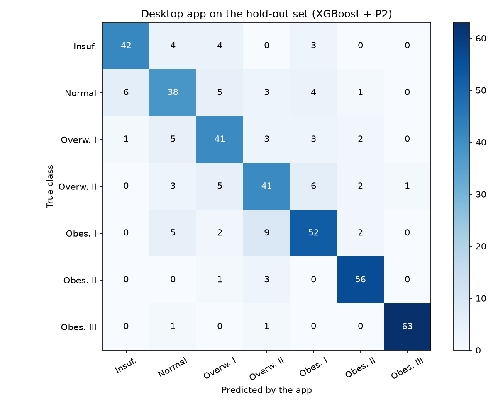

# Evaluación de la app de escritorio

Este documento explica cómo comprobar qué tan bien clasifica la app y presenta los resultados obtenidos.

## Qué se mide

Cada persona del conjunto de prueba pasa por `app_obesidad.core.predict`, la misma función que ejecuta la ventana al presionar el botón de predicción. Por eso la prueba mide la app completa, incluida la conversión de las respuestas del formulario a las 17 columnas del modelo, y no solo el archivo `.pkl`.

El conjunto de prueba es el mismo de `Notebook_Matriz.ipynb` (celdas 1, 2 y 16):

| Paso | Valor |
| --- | --- |
| Datos | UCI, id 544, descargados con `ucimlrepo` |
| Duplicados | Se eliminan antes de dividir |
| Partición | `train_test_split(test_size=0.2, stratify=y, random_state=20)` |
| Estratificación | Sobre la clase codificada de 0 a 6, igual que el notebook |
| Filas de prueba | 418 |

## Cómo repetirlo

Desde la raíz del repositorio, en la rama `feat/app-escritorio`:

```
uv run --group eval python scripts/evaluar_app.py
```

Se necesita conexión a internet para descargar el dataset. La app debe estar cerrada: en Windows, una ventana abierta bloquea archivos del entorno virtual y `uv` falla al instalar las dependencias de evaluación.

El script imprime las métricas y guarda:

- `modelos/evaluacion_app.json`: métricas, matriz de confusión y predicciones de los perfiles de demostración.
- `docs/img/evaluacion_app_matriz_confusion.png`: la matriz de confusión.

## Resultados (28/11/2026)

| Métrica | App | Notebook |
| --- | --- | --- |
| Exactitud | 0.7967 | 0.7967 |
| F1 macro | 0.7939 | 0.7939 |
| Filas rechazadas | 0 de 418 | — |
| Tiempo por persona | ~17 ms | — |

La app reproduce exactamente las métricas del notebook. Eso confirma que la codificación del formulario y la carga del modelo en Windows no alteran las predicciones.

| Clase | Precisión | Recall | F1 |
| --- | --- | --- | --- |
| Insufficient_Weight | 0.857 | 0.792 | 0.824 |
| Normal_Weight | 0.679 | 0.667 | 0.673 |
| Overweight_Level_I | 0.707 | 0.745 | 0.726 |
| Overweight_Level_II | 0.683 | 0.707 | 0.695 |
| Obesity_Type_I | 0.765 | 0.743 | 0.754 |
| Obesity_Type_II | 0.889 | 0.933 | 0.911 |
| Obesity_Type_III | 0.984 | 0.969 | 0.977 |



### Lectura

- Los extremos se clasifican muy bien: Obesity_Type_III (F1 0.98) y Obesity_Type_II (F1 0.91).
- Las clases intermedias son las más difíciles: Normal_Weight y los dos niveles de sobrepeso (F1 entre 0.67 y 0.73). Los errores caen casi siempre en una clase vecina, por ejemplo Obesity_Type_I confundida con Overweight_Level_II.
- El modelo solo usa hábitos, antecedentes, edad y género. No usa peso ni estatura, así que estos errores entre clases vecinas son esperables.

## Perfiles para la demostración en clase

| Perfil | Predicción | Tres clases más probables |
| --- | --- | --- |
| Estudiante activa con hábitos sanos | Insufficient_Weight | Insufficient 49 %, Normal 48 %, Overweight II 1 % |
| Oficinista sedentario | Overweight_Level_II | Overweight II 59 %, Obesity II 41 %, Overweight I 0 % |
| Hábitos de alto riesgo | Obesity_Type_III | Obesity III 100 % |

Los valores exactos de cada perfil están en `DEMO_PROFILES`, dentro de `scripts/evaluar_app.py`, para escribirlos en la ventana durante la presentación.

### Advertencia sobre el género

El perfil de alto riesgo es una mujer y el modelo responde Obesity_Type_III con 100 %. Esto refleja el sesgo del SMOTE documentado en el informe: en el dataset, Obesity_Type_II es casi solo de hombres y Obesity_Type_III casi solo de mujeres. Conviene mostrarlo en clase como limitación del modelo, no como un acierto.
