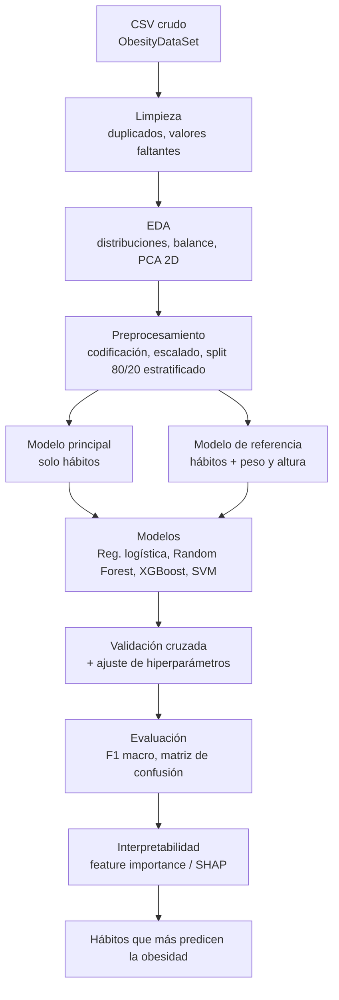

# Parte 3: Descripción de la solución y diagrama esquemático

## Objetivo

Predecir el nivel de obesidad de una persona (`NObeyesdad`) a partir de sus **hábitos**: alimentación, actividad física, consumo de agua y alcohol, medio de transporte, uso de tecnología, entre otros.

## Hallazgos sobre el dataset

### 1. El CSV del repositorio tiene los decimales dañados

- El separador es `;` (no `,`).
- En las filas sintéticas el punto quedó como separador de miles. Ejemplos:

| Variable | Valor en el CSV | Valor real |
|---|---|---|
| Height | `1.616.366` | `1.616366` |
| Weight | `67.183.128` | `67.183128` |

**Decisión:** reemplazar el CSV por el original de [UCI](https://archive.ics.uci.edu/dataset/544/estimation+of+obesity+levels+based+on+eating+habits+and+physical+condition) en lugar de corregirlo.

- El original está verificado: separador `,`, decimales correctos (ej. `25.196214`) y las mismas 2.111 filas.
- Corregir el archivo dañado no es confiable: la posición del decimal depende de cada columna (ej. `FCVC = 121.498` debería ser `1.21498`, ya que su rango es 1-3, mientras que `Weight = 67.183.128` es `67.183128`). Un error ahí introduce datos falsos sin que se note.

### 2. Riesgo de fuga de datos (data leakage)

La clase objetivo se calcula con el IMC (`peso / altura²`). Si el modelo recibe `Height` y `Weight`, alcanza ~97% de precisión sin aprender nada útil: solo recalcula el IMC.

**Propuesta (en discusión):**

- **Modelo principal:** solo hábitos (sin `Height` ni `Weight`).
- **Modelo de referencia:** con peso y altura, únicamente para comparar.

## Variable objetivo: 7 clases vs. 3 grupos

Clases del dataset: `Insufficient_Weight`, `Normal_Weight`, `Overweight_Level_I`, `Overweight_Level_II`, `Obesity_Type_I`, `Obesity_Type_II`, `Obesity_Type_III`.

| | 7 clases | 3 grupos (bajo peso / normal / exceso) |
|---|---|---|
| Dificultad | Mayor (confunde clases vecinas) | Menor |
| Precisión esperada | Más baja | Más alta |
| Balance | Balanceado | Desbalanceado ("exceso" agrupa 5 clases) |
| Utilidad | Diagnóstico detallado | Alerta temprana / prevención |

**Decisión del equipo:** se usan las **7 clases** tal como vienen en el dataset. La agrupación en 3 queda solo como alternativa si el rendimiento es bajo.

## Pipeline propuesto

1. **Limpieza:** carga del CSV original de UCI, revisión de duplicados y valores faltantes.
2. **EDA:** distribuciones, balance de clases, proyección PCA 2D.
3. **Preprocesamiento:** codificación de categóricas (ordinal / one-hot), escalado, split 80/20 estratificado.
4. **Modelos:** Regresión logística (baseline), Random Forest, XGBoost, SVM.
5. **Validación cruzada** y ajuste de hiperparámetros.
6. **Evaluación:** F1 macro y matriz de confusión.
7. **Interpretabilidad:** importancia de variables / SHAP (qué hábitos pesan más).

## Diagrama esquemático

## Uso de PCA (visto en clase)

Se usa como **pieza secundaria**, no como paso central:

- **Sí:** en el EDA, para una gráfica 2D (PC1 vs PC2) coloreada por clase.
- **Sí (opcional):** como experimento antes de Regresión logística, SVM o KNN, comparando con y sin PCA.
- **No** como paso obligatorio, porque:
  - Hay pocas variables (16 originales, ~25-30 tras one-hot) para 2.111 registros.
  - Se pierde la interpretabilidad de los hábitos, que es el objetivo del proyecto.
  - PCA asume variables continuas y la mayoría son categóricas/ordinales (la alternativa formal para datos mixtos es FAMD).
  - Random Forest y XGBoost no lo necesitan.

**Reglas al aplicarlo:** escalar antes de PCA y ajustarlo solo con el conjunto de entrenamiento (dentro de un `Pipeline`) para evitar fuga de datos.

## Pendiente

- [x] Confirmar con el equipo: 7 clases o 3 grupos → **7 clases**.
- [x] Decidir: corregir el CSV actual o usar el original de UCI → **original de UCI**.
- [ ] Reemplazar `dataset/ObesityDataSet_raw_and_data_sinthetic.csv` en el repositorio.
- [ ] Pasar el diagrama a la diapositiva.
